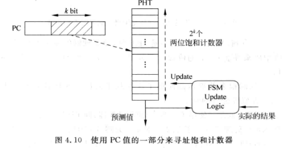
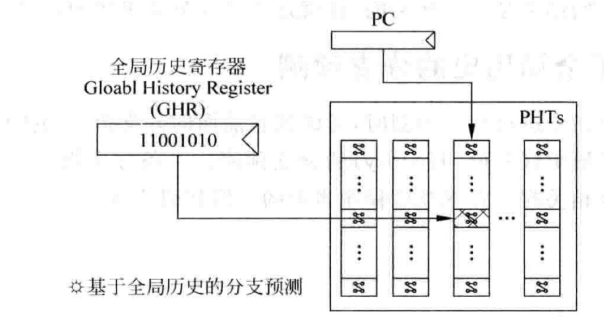

# 分支预测

## 1. 基本概念

### 1.1 动态分支预测
（1）动态分支预测是能够根据处理器实际的执行情况，动态地对分支指令进行预测；不会简单地预测分支指令一直发生跳转或者不跳转，而是会根据分支指令在过去一段时间的执行情况来决定预测的结果，也就是称之为“动态”的原因。

（2）方向预测：分支指令的方向只有两个，发生跳转（taken）和不发生跳转（not taken）。

（3）目标地址预测：分支指令的目标地址（target address）可以分为两种，直接跳转（PC-relative）和间接跳转（absolute）。对于直接跳转，由于它的偏移值（offset）以立即数的形式固定在指令中，其目标地址是固定的，记录下这条分支指令的目标地址即可；对于间接跳转，其目标地址来自于通用寄存器，通用寄存器的值是会经常变化的，对这种类型的分支指令来说，进行目标地址的预测不是一件容易的事，但程序中大部分间接跳转分支指令是处理子程序调用的call和return指令，这两种指令的目标地址是有规律可循的，因此可以对其进行预测。大部分超标量处理器都会推荐编译器的设计者，除使用call/return指令之外，尽量减少使用其他间接跳转类型的分支指令，多使用直接跳转类型的分支指令，有助于提升分支预测的准确度。

（4）总结：使用BHR/GHR/饱和计数器配合来对分支指令的方向进行预测；使用BTB/RAS/Target Cache对分支指令的目标地址进行预测；这些预测都是发生在取指阶段，即基于PC值来进行的；

（5）饱和计数器捕捉跳转规律：对于2bit寄存器，数值为2'b11,表示strongly taken，计数器处于饱和状态，分支指令此次预测跳转；数值为2'b10,表示weakly taken，计数器处于不饱和状态，分支指令此次预测跳转；数值为2'b01，表示weakly not taken, 计数器处于不饱和状态，分支指令此次预测不发生跳转；数值为2'b00,表示strongly not taken，计数器处于饱和状态，分支指令预测不跳转。下图中的PHT中的每一项都是2bit的饱和计数器，对于每一个分支的PC，都有一个2bit的饱和计数器；若用PC中的k bit来寻址PHT，则PHT共有2^k项，总的大小为2^k * 2 bit。

（6）PHT(pattern history table)：是一个表格，其中存放着所有PC值（或者是PC值的一部分）对应的两位饱和计数器的值。

（7）BHR(branch history register)：分支历史寄存器，对一条分支指令来说，通过将它每次的结果（跳转1/不跳转0）移入BHR，就可以记录这条分支指令的历史状态了，如果这条分支指令很有规律，就可以用BHR来对这条分支指令进行预测，称之为局部历史（local history）的预测方法。理论上，每条分支指令都有自己对应的BHR和PHT，一个n位的BHR需要PHT的大小为2^n×2bit，如果为每条指令都配一个BHR和PHT，需要很大的存储空间，将所有分支指令的BHR组合在一起称为分支历史寄存器表（BHT, branch history register table）。实际上BHT不能照顾到每个PC，一般都是使用PC的一部分来寻址BHT，相当于一些PC共用一个BHR，同时PHT占用大量存储空间，更需要被复用。下图是一个示意图。

（8）GHR(global history register)：全局历史寄存器，基于全局历史的分支预测方法中，使用GHR记录程序中所有的分支指令在过去的执行情况。现实中GHR的宽度不能无限大，故使用一个有限位宽的GHR来记录最近执行的所有分支指令的结果，每遇到一条分支指令，则将这条分支指令的结果插入到GHR的右边，最左边被移除的位会被抛弃掉。使用GHR预测的时候，还需要借助PHT，使用GHR寻址PHT，PHT仍由饱和计数器组成，使用饱和计数器来捕捉GHR的规律。

