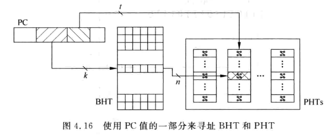
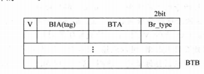
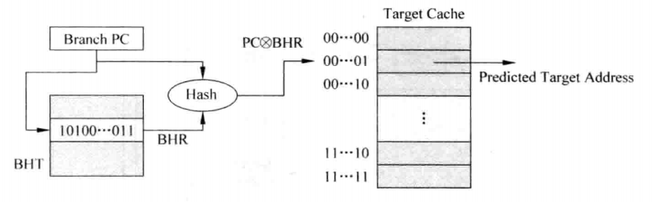

# 分支预测

## 1. 基本概念

### 1.1 动态分支预测 方向预测
（1）动态分支预测是能够根据处理器实际的执行情况，动态地对分支指令进行预测；不会简单地预测分支指令一直发生跳转或者不跳转，而是会根据分支指令在过去一段时间的执行情况来决定预测的结果，也就是称之为“动态”的原因。

（2）方向预测：分支指令的方向只有两个，发生跳转（taken）和不发生跳转（not taken）。

#### 1.1.1  饱和计数器捕捉跳转规律
（3）对于2bit寄存器，数值为2'b11,表示strongly taken，计数器处于饱和状态，分支指令此次预测跳转；数值为2'b10,表示weakly taken，计数器处于不饱和状态，分支指令此次预测跳转；数值为2'b01，表示weakly not taken, 计数器处于不饱和状态，分支指令此次预测不发生跳转；数值为2'b00,表示strongly not taken，计数器处于饱和状态，分支指令预测不跳转。下图中的PHT中的每一项都是2bit的饱和计数器，对于每一个分支的PC，都有一个2bit的饱和计数器；若用PC中的k bit来寻址PHT，则PHT共有2^k项，总的大小为2^k * 2 bit。

#### 1.1.2 PHT/BHR/GHR
（4）PHT(pattern history table)：是一个表格，其中存放着所有PC值（或者是PC值的一部分）对应的两位饱和计数器的值。

（5）BHR(branch history register)：分支历史寄存器，对一条分支指令来说，通过将它每次的结果（跳转1/不跳转0）移入BHR，就可以记录这条分支指令的历史状态了，如果这条分支指令很有规律，就可以用BHR来对这条分支指令进行预测，称之为局部历史（local history）的预测方法。理论上，每条分支指令都有自己对应的BHR和PHT，一个n位的BHR需要PHT的大小为2^n×2bit，如果为每条指令都配一个BHR和PHT，需要很大的存储空间，将所有分支指令的BHR组合在一起称为分支历史寄存器表（BHT, branch history register table）。实际上BHT不能照顾到每个PC，一般都是使用PC的一部分来寻址BHT，相当于一些PC共用一个BHR，同时PHT占用大量存储空间，更需要被复用。下图是一个示意图。

（6）GHR(global history register)：全局历史寄存器，基于全局历史的分支预测方法中，使用GHR记录程序中所有的分支指令在过去的执行情况。现实中GHR的宽度不能无限大，故使用一个有限位宽的GHR来记录最近执行的所有分支指令的结果，每遇到一条分支指令，则将这条分支指令的结果插入到GHR的右边，最左边被移除的位会被抛弃掉。使用GHR预测的时候，还需要借助PHT，使用GHR寻址PHT，PHT仍由饱和计数器组成，使用饱和计数器来捕捉GHR的规律。

GHR中的每一bit都是一个分支指令，例如分支b3/b2是2'b11，则要进来的b1是1'b0，经过训练时间之后，这种规律就可以被GHR捕捉并记录下来，后续如果出现2'b11的情况，就会预测b1不跳转了；这里的全局指的是全局的分支指令；理想情况下每条分支指令都使用一个PHT，这样每条分支指令都会使用当前的GHR来寻址自身对应的PHT，这样组成的表格称为PHTs。

#### 1.2.3 两种分支预测方法
方法一：基于分支指令自身在过去的执行状况来进行分支预测，对每条分支指令都使用了BHR，并使用了两位饱和计数器组成的PHT来捕捉每个BHR的规律，使用BHR和PHT配合来进行分支预测，这种方法称为基于局部历史（local history）的分支预测法；
方法二：基于一条分支指令之前的一些分支指令的执行状况来进行分支预测，使用了全局历史寄存器（GHR）来记录所有分支指令的执行情况，并使用了两位饱和计数器组成的PHT来捕捉GHR的规律，使用GHR和PHT配合来进行分支预测，这种方法称为基于全局历史（global history）的分支预测法；
使用BHR/GHR/饱和计数器配合来对分支指令的方向进行预测；使用BTB/RAS/Target Cache对分支指令的目标地址进行预测；这些预测都是发生在取指阶段，即基于PC值来进行的；

（8）分支预测的更新
需要更新的有：历史寄存器，即GHR/BHR; 两位饱和计数器，不管是基于全局历史还是局部历史的分支预测方法，都需要在PHT中使用饱和计数器来步骤历史寄存器的规律，因此也需要对饱和计数器进行更新；

对于基于全局历史的预测中，可以在流水线的取指令阶段，进行分支预测时，根据预测的结果更新GHR，因为不能保证此时GHR的更新是完全正确的，这样的更新称为推测的（speculative）；可以在commit阶段放一个retired GHR，在分支指令退休的时候将结果更新到这个GHR中，当一条分支指令发现分支预测失败的时候，前端的GHR是错的，将后端的GHR写到前端的GHR完成修复；也可以使用checkpoint修复法，在取指令的极端对前端的GHR进行更新的同时，将旧的GHR值保存起来，保存的值称为checkpoint GHR，分支预测失败，将分支指令对应的checkpoint GHR恢复到前端GHR中，并从这条分支指令正确的目标地址开始取指令执行。

对于基于局部历史的预测中，由于BHR存储的是当前分支指令自身在过去的执行情况，一般情况下只有当循环体很短的时候，才可能出现一条分支指令在流水线的提交阶段更新BHR时，流水线中又出现了这条分支指令使用BHR进行分支预测的情况，所以可以在分支指令退休的时候更新BHR，简化设计，不会对处理器性能产生很大负面影响。

这两种分支预测中，一般都是在分支指令退休的时候对PHT中的饱和计数器进行更新。

### 1.2 动态分支预测 目标地址预测
（1）目标地址预测：分支指令的目标地址（target address）可以分为两种，直接跳转（PC-relative）和间接跳转（absolute）。对于直接跳转，由于它的偏移值（offset）以立即数的形式固定在指令中，其目标地址是固定的，记录下这条分支指令的目标地址即可；对于间接跳转，其目标地址来自于通用寄存器，通用寄存器的值是会经常变化的，对这种类型的分支指令来说，进行目标地址的预测不是一件容易的事，但程序中大部分间接跳转分支指令是处理子程序调用的call和return指令，这两种指令的目标地址是有规律可循的，因此可以对其进行预测。大部分超标量处理器都会推荐编译器的设计者，除使用call/return指令之外，尽量减少使用其他间接跳转类型的分支指令，多使用直接跳转类型的分支指令，有助于提升分支预测的准确度。

#### 1.2.1 直接跳转
分支指令不跳转时，目标地址 = 分支指令PC + sizeof(fetch group)
分支指令跳转时，目标地址 = 分支指令PC + sign_extend(offset)
分支预测是基于PC值进行的，不可能对每一个PC值都记录下的它的目标地址，所以一般使用cache的形式，使多个PC值共用一个空间来存储目标地址，这个cache称为BTB（branch target buffer）。BTB本质上是cache，它的结构和cache也是一样的，使用PC的一部分来寻址BTB(index)，PC值的其他部分称为tag，BTB中存放着分支指令的目标地址(BTA, branch target address)。index部分相同的多个PC值会查找到BTB中同一个地址，使用tag来区分；当这些PC值中存在多于一条的分支指令时，产生了冲突，会造成BTB中对应的内容被频繁替换，影响了分支预测的准确度。

上述的意思是用一张小表缓存最近用过的分支指令的目标地址，类似于cache，cache也不是缓存整个内存，而是缓存最近用过的数据块。

#### 1.2.2 间接跳转
间接跳转（absolute）类型的分支指令，目标地址来自于通用寄存器，是经常变化的，无法通过BTB对它的目标地址进行准确的预测，大部分间接跳转类型的分支指令都是用来进行子程序调用的call/return指令，这两种指令是有规律的；

call指令用来调用子程序，由于每次调用的子程序都是固定的，call指令对应的目标地址是固定的，可以使用BTB对call指令的目标地址进行预测；

return指令目标地址是不确定的，无法用BTB对它的目标地址进行预测，但是可以看出，return指令的目标地址总是等于最近一次执行的call指令的下一条指令的地址，所以可以设计一个存储器，保存罪进行执行的call指令的下一条指令的地址，并且这个存储器是后进先出的（LIFO, last in first out），符合return和call指令的特点，这个存储器的工作原理和堆栈（stack）是一样的，称之为返回地址堆栈（RAS, return address stack）；

遇到call指令的时候，需要将call指令的下一条指令的地址放到RAS，需要识别哪条是call指令，正常情况下只有到了decode阶段才知道指令是否是call指令，可以将PC+4存入到RAS中；可以通过PC值来指导是否是call指令，可以借用BTB，因为BTB中保存了所有发生跳转的分支指令，而call/return指令是永远会跳转的，如果将分支指令写到BTB的时候，也将其类型（call, return, 其他类型）记录在BTB中，在遇到这个PC值的时候，通过查询BTB就可以知道它的类型了，可以在分支预测阶段识别call指令，将PC+4的值保存到RAS; 识别return指令，选择RAS的输出作为目标地址的值，而不是BTB的值

#### 1.2.3 其他间接跳转
对于间接跳转类型的分支指令，如果既不是call，也不是return，其目标地址可能是和过去的执行情况有关系，可以利用基于局部历史的分支预测方法中使用的BHR对目标地址进行预测，如下图

所示的方法已经在分支指令的方向预测中出现过，只是将PHT换成了target cache，对于一条间接跳转类型的分支指令来说，每执行一次，就将目标地址写入到target cache中，由于间接跳转分支指令的目标地址可能的值是有限的，所以target cache可以覆盖到所有情况；

#### 1.2.4 总结
对于分支指令的目标地址的预测，有下面三种方法
（1）使用BTB对直接跳转（PC-relative）类型的分支指令和call指令进行预测；
（2）使用RAS对return指令进行预测；
（3）使用target cache对其他类型的分支指令进行预测；